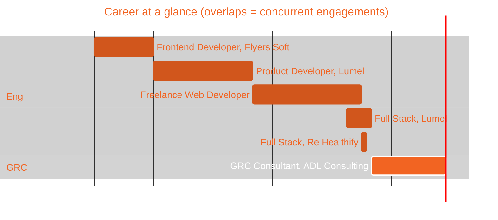

<div align="center">


<br/>

[](https://git.io/typing-svg)

<br/>

📍 UK (Open to Relocate) &nbsp;|&nbsp; 📧 shahidsha.1612@gmail.com &nbsp;|&nbsp; 📱 +44 7407 001987

[](https://linkedin.com/in/shaid-hussain-651b06134/)
[](mailto:shahidsha.1612@gmail.com)
[](https://github.com/shahidsha1612)

</div>


---

### `> whoami`

```yaml
role:        GRC & Information Security Engineer @ ADL Consulting
specialty:   ISO/IEC 27001:2022 ISMS | Risk & Internal Audit | ISO/IEC 42001 AI Governance
certified:   PECB ISO/IEC 27001 Lead Auditor | AWS Certified AI Practitioner | CGE-P | CGE-AUD | CGE-AZ
audits:      30+ internal audits led, ~60 external audits supported
background:  ~5 years commercial software engineering (MERN stack)
superpower:  Writing the evidence, not just the policy
currently:   Running ISMS programmes across 7 concurrent clients (defence, SaaS, research, nonprofit)
building:    Project Veridian, automated ISO 27001 Annex A evidence (in public, on LinkedIn)
community:   Director of Events, London Chapter, GRC Engineering Club
teaching:    Automated Access Reviews on AWS, an educational series (LinkedIn)
```

I bridge the gap between the boardroom and the codebase, testing whether controls are technically viable before they hit a Statement of Applicability, then translating the risk into plain English for directors and holding that ground under challenge.

---

### 🔐 Core Skills - GRC, Risk & Security


---

### 🏆 Highlights

| | |
|---|---|
| 🏅 | Built the ISMS for a **UK defence supply chain manufacturer** and took them through to **ISO/IEC 27001 certification** |
| 🔐 | ISO/IEC 27001:2022 ISMS delivery across **7 concurrent client engagements** |
| 🧭 | Led **30+ internal audits** and supported **~60 external audits**, including one programme spanning 8 departments end to end |
| 📊 | Mapped **85 SoA controls to 76 live risk entries** with a programmatic validation gate for certification-ready traceability |
| 🛡️ | **NIST SP 800-171** gap analysis (110 controls) for a defence supply chain manufacturer, supporting CMMC readiness |
| 📣 | Ran a **security awareness campaign across 7 UK locations**, with phishing simulations, training videos and a monthly security newsletter |
| ⚙️ | Shipped an SSM app now used by a **top-10 UK financial sector company** |
| 🤝 | Director of Events for the **London chapter of the GRC Engineering Club**, running the chapter's events and mentoring people moving into GRC through 1-1 sessions |

---

### 📜 Certifications & Education

- 🎓 **PECB ISO/IEC 27001 Lead Auditor**
- 🎓 **AWS Certified AI Practitioner (AIF-C01)**
- 🎓 **Certified GRC Engineer, Practitioner (CGE-P)**
- 🎓 **Certified GRC Engineer, Auditor Specialty (CGE-AUD)**
- 🎓 **Certified GRC Engineer, Azure Specialty (CGE-AZ)**
- 🎓 **ISO/IEC 42001 AI Management Systems Masterclass**
- 🎓 **ISO 9001:2015 Quality Management Systems**
- 🎓 **Diploma in Information Security**, University of Surrey
- 🎓 **BTech Information Technology**, BSA Crescent Institute of Science & Technology

---

### 💼 Featured Projects

<table>
<tr>
<td colspan="2" valign="top">

**🧪 [Project Veridian](https://github.com/shahidsha1612/veridian-iso27001) — Compliance as Infrastructure for ISO/IEC 27001**
*Building in Public · LinkedIn Series*

What would an ISMS look like if the evidence generated itself? Project Veridian answers that against a fictional identity company, **Veridian Identity**, automating the collection of **ISO/IEC 27001:2022 Annex A** control evidence so that every control claim in the SoA is backed by machine-produced, repeatable proof rather than a screenshot and a promise. Each build step is published as an episode in a LinkedIn series, and the finished evidence set is going in front of a **qualified external auditor**, with the audit report shared publicly.

[](https://github.com/shahidsha1612/veridian-iso27001)

</td>
</tr>
<tr>
<td colspan="2" valign="top">

**🎓 [Automated Access Reviews on AWS](https://github.com/shahidsha1612/demo-access-reviews-1) — An Educational Series**
*Educational Series · LinkedIn · Sessions 1 to 4*

Most access reviews fail for one boring reason: nobody does them on time. This series teaches GRC, risk and compliance professionals, no engineering background needed, how to build an automated AWS access review step by step, in a safe practice setup. Each session is a short walkthrough: how the review works from timer to emailed report, setting up a practice GitHub organisation and our own repo, preparing a practice AWS account (an admin user instead of the root login, MFA, a verified email), then a health check and a dry run so the plan is reviewed before anything is built.

The review runs on a schedule and checks **IAM**, **IAM Access Analyzer**, **Security Hub** and **CloudTrail**. An **Amazon Bedrock** model writes the plain-English summary, each run saves a CSV to a private, encrypted S3 bucket, and the report is emailed out. Practice users with planted problems give it something real to catch, and every session closes with clean-up so nothing keeps running. Based on AJ Yawn's open-source AWS Access Review project (MIT licence), credited and not forked.

`AWS (Lambda, S3, EventBridge, IAM, Security Hub, IAM Access Analyzer, CloudTrail, Bedrock, SES)` · `CloudFormation` · `Bash` · `Python`

[](https://github.com/shahidsha1612/demo-access-reviews-1) [](https://www.linkedin.com/in/shaid-hussain-651b06134/)

</td>
</tr>
<tr>
<td colspan="2" valign="top">

**🛡️ [RepoSentry](https://reposentry.co.uk/) — AI-Powered Supply Chain Security Scanner**
*Live Product*

Built to answer the question every GRC and AppSec team asks before pulling in a dependency: *is this repository actually safe to use?* RepoSentry runs a multi-layer risk assessment on any GitHub repo before it gets cloned into a codebase - live CVE scanning against OSV.dev, hardcoded secrets detection, AI-driven review for obfuscated code and prompt-injection payloads, agent-targeting content detection (hidden Unicode, malicious MCP configs), and author/repository due-diligence scoring (age, maintenance activity, stars).

The differentiator is evidential rigor, not just detection: every AI-reported finding must cite a real file and a verbatim snippet, which is then programmatically re-verified against the source before it's surfaced - eliminating false-positive "assurance" that plagues most scanners. Findings map directly to **ISO/IEC 27001**, **NIST SP 800-53** and **SOC 2** controls, converting ad-hoc third-party risk checks into audit-ready evidence - closing the loop between supply chain security and compliance in a way that satisfies both the engineer and the auditor.

[](https://reposentry.co.uk/)

</td>
</tr>
<tr>
<td colspan="2" valign="top">

**⚖️ [CGE-P Capstone](https://github.com/shahidsha1612/cgep-capstone) — SOC 2 Compliance-as-Code: Prevent, Detect, Prove**
*Certified GRC Engineer, Practitioner Capstone*

Most GRC evidence is a screenshot someone took and hopes nobody questions. This capstone governs a PHI telehealth intake workload against **SOC 2 Trust Services Criteria** and produces evidence an auditor can verify by cryptography rather than by trust. A GitHub Actions pipeline plans the Terraform infrastructure and runs it through a Conftest/OPA policy library of gap-detection rules mapped to SOC 2 controls (**CC6.1** access, **CC6.3** least privilege, **CC6.7** transmission, **A1.2** availability) - blocking merges on real violations and proving it with paired pull requests, one deliberately failed and one fixed. Every applied change is signed keylessly with **Cosign/Sigstore** (GitHub OIDC → Fulcio certificate + public Rekor transparency-log entry) and locked in an S3 Object Lock vault, so a single verify script re-checks the whole chain and prints **CHAIN INTACT** - the write-up even documents a live tamper test against the vault.

The latest addition closes the other half of the control: an **automated access review**. A scheduled, read-only Lambda continuously audits the live account, orchestrating findings from **IAM**, **IAM Access Analyzer** and **Security Hub** into one report, with an **Amazon Bedrock** model writing the executive summary and each run landing as timestamped CSV in a versioned, encrypted bucket. Where the pipeline *prevents* non-compliant change at deploy time, the access review *detects* drift and access risk after it - engineering SOC 2 **CC6.3** periodic access reviews as automation instead of a documented manual process. Prevent, detect, prove - end to end.

`Terraform` · `AWS (Lambda, S3, EventBridge, Security Hub, IAM Access Analyzer, Bedrock)` · `GitHub Actions` · `Conftest / OPA` · `Cosign / Sigstore` · `OSCAL` · `SOC 2 TSC`

[](https://github.com/shahidsha1612/cgep-capstone)

</td>
</tr>
<tr>
<td colspan="2" valign="top">

**☁️ [CGE-AZ Capstone](https://github.com/shahidsha1612/cgeaz) — Continuous Compliance Pipeline on Azure: Detect, Record, Report, Fix**
*Certified GRC Engineer, Azure Specialty Capstone*

Annual audits describe one day. This pipeline describes every day. Built in my own Azure subscription and governed entirely as code, it discovers what is running, collects **Microsoft Defender for Cloud** findings every night into an evidence store I own, writes the **POA&M** and **SAR** from that store alone, and remediates with a human at the approval gate. Evidence lands in **Cosmos DB** stamped with a run ID and timestamp, and reports go into **WORM** storage that refuses deletion even to the subscription owner. Every number in a report traces back to a stored record, and that trace caught a real defect: severity was never being collected, which had quietly given High-risk findings a 90-day deadline instead of 30.

My extensions beyond the course starter: two custom **Azure Policy** controls (management ports open to the internet, plaintext storage), each with a shift-left **OPA** twin in the PR gate; a least-privilege custom role replacing a remediation identity that could quietly list storage keys; a **KQL** tripwire that alerts on out-of-band portal changes; and a **NIST CSF 2.0** crosswalk stored as data across 843 Defender assessments, so the reports show the framework impact of every finding. CI authenticates through keyless **OIDC**, blocks non-compliant Terraform on every pull request (proven with a deliberately failed PR), and checks nightly for drift.

`Terraform (azurerm)` · `Azure Policy` · `Defender for Cloud` · `Cosmos DB` · `Azure Functions (Python)` · `Log Analytics / KQL` · `GitHub Actions` · `Conftest / OPA` · `NIST CSF 2.0`

[](https://github.com/shahidsha1612/cgeaz)

</td>
</tr>
<tr>
<td width="50%" valign="top">

**🔗 ISO/IEC 27001 Certification Delivery**
*UK Defence Supply Chain Manufacturer*

Designed and built the ISMS from the ground up, ran the internal audits alongside the client team, and carried the organisation through to ISO/IEC 27001 certification.

</td>
<td width="50%" valign="top">

**🔗 NIST SP 800-171 Gap Analysis**
*Defence Supply Chain Manufacturer*

Reviewed 110 controls against an existing SSP, producing a prioritised remediation roadmap supporting CMMC readiness.

</td>
</tr>
<tr>
<td width="50%" valign="top">

**🔗 ISMS Risk & Control Assurance**
*Seven Client Portfolio*

Owns risk assessment, control mapping and internal audit workstreams across 7 concurrent clients spanning defence supply chain, SaaS, research, nonprofit and professional services. Built a traceable evidence chain from SoA controls through to internal audit findings.

</td>
<td width="50%" valign="top">

**🔗 Multi-Department Internal Audit Programmes**
*Software & Defence Clients*

Planned and led full ISO/IEC 27001:2022 internal audit programmes across multiple departments end to end, including audit plans, control matrices and CAPA tracking. 30+ internal audits led to date.

</td>
</tr>
<tr>
<td width="50%" valign="top">

**🔗 Security Awareness Programme**
*Multi-Site UK Client*

Delivered a security awareness campaign across seven UK locations: coordinated phishing simulations, produced training videos and internal comms, and author a monthly information security newsletter distributed across every client account.

</td>
<td width="50%" valign="top">

**🔗 Simple Supplier Management (SSM)**
*Live SaaS Product*

Centralises supplier records, certifications, renewal dates and risk ratings. Implements ISO/IEC 27001 controls A.5.19-A.5.22 in production. Live at a top-10 UK financial sector company.

</td>
</tr>
</table>

---

### 🛠️ Also Building With (Dev Background)

5 years of commercial MERN stack engineering underpins the technical side of the GRC work above.


---

### 🧭 Experience Timeline

<div align="center">

`2021` 💻 **Frontend** &nbsp;→&nbsp; `2022` 🧩 **Product** &nbsp;→&nbsp; `2023` 🛠️ **Full Stack** &nbsp;→&nbsp; `2025` 🔐 **GRC & Security**

</div>



<table>
<tr>
<td colspan="2" align="center">

**🔐 GRC & Security Engineering** &nbsp;·&nbsp; <sub>2025 → today</sub>

</td>
</tr>
<tr>
<td width="28%" align="center" valign="top">


<br/>

<br/>
<sub>📍 UK</sub>

</td>
<td valign="top">

🟠 **Information Security & GRC Consultant**  
*ADL Consulting Ltd*

- Delivering end to end **ISO/IEC 27001:2022** ISMS implementation, certification readiness and maintenance across **7 concurrent clients** (defence supply chain, SaaS, research, non-profit, professional services)
- Planning and leading **multi-department internal audit programmes**, reporting nonconformities and **CAPA** to senior management and tracking them through to closure
- Leading **third party risk management**: vendor certifications, DPAs, data residency and UK GDPR processor obligations, kept in structured supplier risk registers
- Gap analysis and remediation roadmaps against **ISO 9001**, **ISO/IEC 42001**, **NIST SP 800-171** and **Cyber Essentials / CE+**
- Testing whether controls are technically viable **before** they reach the SoA, then explaining the risk in plain language to client directors

`ISO 27001` · `ISO 42001` · `NIST 800-171` · `Internal Audit` · `CAPA` · `TPRM` · `BC/DR`

</td>
</tr>
<tr>
<td colspan="2" align="center">

**💻 Software Engineering** &nbsp;·&nbsp; <sub>2021 → 2025 · the foundation for security by design</sub>

</td>
</tr>
<tr>
<td width="28%" align="center" valign="top">


<br/>
<sub>📍 UK</sub>

</td>
<td valign="top">

🔸 **Full Stack Developer**  
*Re:Healthify · concurrent engagement*

- Took an **AI health platform** to production with data protection and privacy controls **designed in from day one**
- Built electronic health record (EHR) data flows around **data minimisation** and **access control**, not added afterwards

`Privacy by Design` · `Healthcare Data` · `AI`

</td>
</tr>
<tr>
<td width="28%" align="center" valign="top">


<br/>
<sub>📍 Remote</sub>

</td>
<td valign="top">

🔸 **Full Stack Developer**  
*Lumel · concurrent*

- Applied secure development practice (**input validation**, **authentication flow design**, **dependency management**) across an enterprise analytics product lifecycle

`Secure SDLC` · `React` · `Node.js`

</td>
</tr>
<tr>
<td width="28%" align="center" valign="top">


<br/>
<sub>📍 UK</sub>

</td>
<td valign="top">

🔸 **Web Developer**  
*Freelance · concurrent side engagements*

- Full stack delivery for **international clients**, owning scoping, timelines and handover documentation end to end

`React` · `Node.js` · `Client Delivery`

</td>
</tr>
<tr>
<td width="28%" align="center" valign="top">


<br/>
<sub>💼 Full-time</sub>

</td>
<td valign="top">

🔸 **Product Developer**  
*Lumel*

- Built complex **React + TypeScript** product features and reusable component libraries
- 📈 **+45%** measured user satisfaction &nbsp;·&nbsp; ⚡ **−25%** development time on new projects &nbsp;·&nbsp; 🎯 **95%** on-time delivery across 3 concurrent Agile projects

`React` · `TypeScript` · `Component Libraries` · `Agile`

</td>
</tr>
<tr>
<td width="28%" align="center" valign="top">


<br/>
<sub>🌱 First role</sub>

</td>
<td valign="top">

🔹 **Frontend Developer**  
*Flyers Soft · where it all started*

- First commercial engineering role: React frontend features and direct client delivery from requirements through to production release

`React` · `JavaScript`

</td>
</tr>
</table>

---

<div align="center">

### 📩 Let's Connect

Open to Information Security, Cybersecurity and GRC roles, plus consulting and audit engagements.

[](https://linkedin.com/in/shaid-hussain-651b06134/)
[](mailto:shahidsha.1612@gmail.com)

</div>
